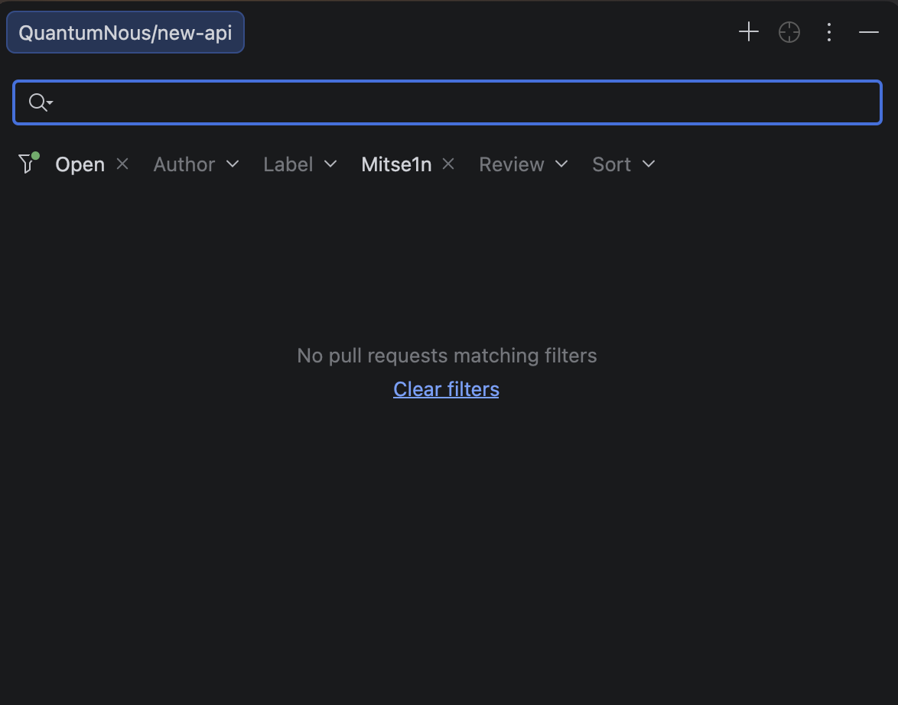
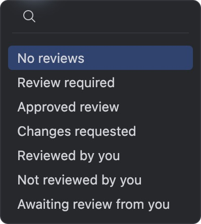
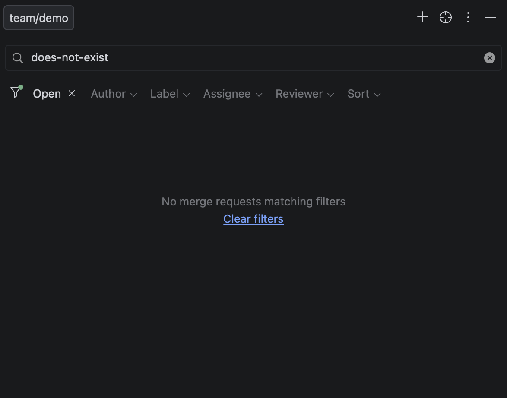

# IntelliJ Reviews alignment — 2026-10-14

The requested target is the GitHub/GitLab request tool window. Git remains first in GitDesk's left toolbar, as requested; IntelliJ's IDE-wide tool order is not copied over that product decision.

## Evidence and steps

1. **Request list — inspected live.** Computer Use connected to IntelliJ's `new-api – README.md` window. The repository is a tool-window title tab, followed by a search field and horizontal filter row. The user's cropped reference below shows the same structure. GitDesk previously showed two Code Reviews titles, a status block, native origin/state dropdowns, a Requests/Load More header, and unselected detail tabs. Those elements have been replaced.
2. **State, review and quick filters — inspected live.** Opened State (Open, Closed, Merged), Review (seven review outcomes), and Quick Filters. Executing the quick-filter choice cleared the assignee constraint and loaded the request list. GitDesk now supports removable filters, Clear filters, quick presets, and server-side search and filtering across the repository rather than filtering only the first fetched page. GitLab uses its own reviewer and sort choices.
3. **Request opening and return — source checked, fixture verified.** `GHPRListComponentFactory` registers Enter and double-click to open a request. GitDesk now leaves single-click selection in the list, opens with Enter/double-click, hides detail tabs until a request is opened, and supports returning to the list and revealing the opened request. Further live IntelliJ detail capture was blocked by repeated native Computer Use errors (`cannotClickOffscreenElement`, `noWindowsAvailable`, then timeout). No claim of live detail parity is made.
4. **Loading, empty and failure states — source checked, fixture verified.** `GHPRListPanelFactory` wraps the list in lazy scrolling; `GHPRListPanelController` separates loading, no matches, no requests, and API failure. `StatusText` places its empty content above center at one third of the available height. GitDesk follows these behaviors and retries failures. The generated screenshots use a 587×461-point sidebar, matching the supplied 1174×922-pixel reference.

## Screenshots

User-supplied IntelliJ reference:

Live IntelliJ Review menu captured during this run:

GitDesk GitHub empty state (test fixture):

GitDesk GitLab empty state (test fixture):

## Source references

Inspected the local IntelliJ Community checkout, including:

- `plugins/github/github-core/src/org/jetbrains/plugins/github/pullrequest/ui/list/GHPRListPanelFactory.kt`: search panel margins and lazy vertical loading.
- `plugins/github/github-core/src/org/jetbrains/plugins/github/pullrequest/ui/list/GHPRListPanelController.kt`: loading, empty and error states.
- `plugins/github/github-core/src/org/jetbrains/plugins/github/pullrequest/ui/list/GHPRListComponentFactory.kt`: request metadata, comments, Enter and double-click.
- `plugins/github/github-core/src/org/jetbrains/plugins/github/pullrequest/ui/filters/GHPRSearchPanelFactory.kt`: filter order and options.
- `plugins/github/github-core/src/org/jetbrains/plugins/github/pullrequest/ui/filters/GHPRListSearchValue.kt`: repository-wide search qualifiers and sorting.
- `platform/collaboration-tools/src/com/intellij/collaboration/ui/codereview/list/search/ReviewListSearchPanelFactory.kt`: search above filters, spacing, horizontal scrolling.
- `platform/platform-api/src/com/intellij/util/ui/StatusText.java`: above-center empty-state positioning.
- `plugins/gitlab/gitlab-core/src/org/jetbrains/plugins/gitlab/mergerequest/ui/filters/GitLabMergeRequestsFiltersValue.kt`: GitLab author, assignee and reviewer parameters.

GitLab query parameters were also checked against the [official merge requests API](https://docs.gitlab.com/api/merge_requests/).

## Validation and limits

The 52 core scenarios and AppKit UI checks pass, including query encoding, page parameters, GitHub/GitLab filters, cancellation, single-selection behavior, reopening, empty state, clearing filters, action availability, window resizing and themes. No authenticated review writes were performed against a live repository.

The existing native account dialog remains. Author menus offer loaded authors plus explicit username entry; label, assignee and GitLab reviewer selection use native input dialogs, rather than IntelliJ's incremental member/label chooser. GitDesk does not contain IntelliJ's general-purpose editor, so the space beside the unopened list stays empty rather than showing an unrelated source document. Full accessibility compliance was not audited; controls have accessibility labels and Enter navigation, while a complete VoiceOver pass remains unverified.
