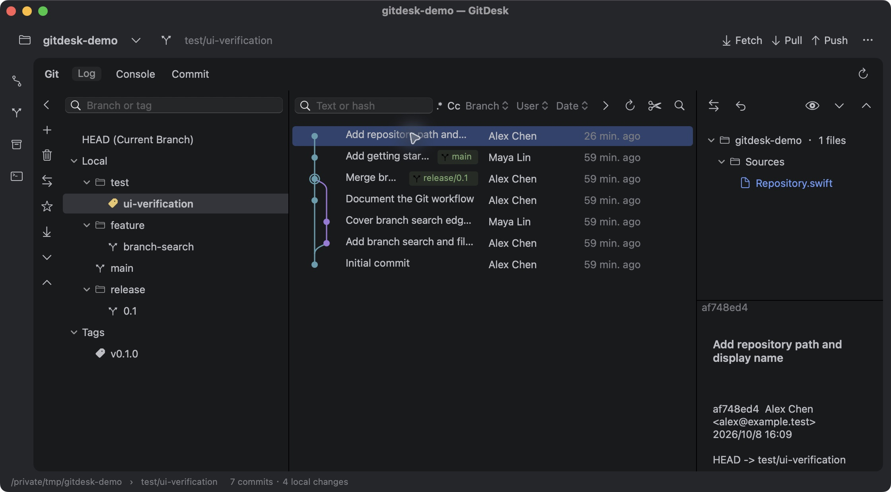
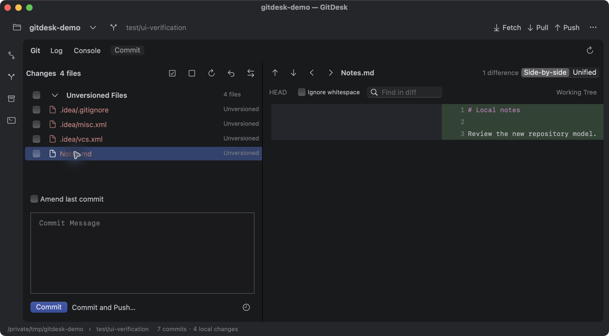
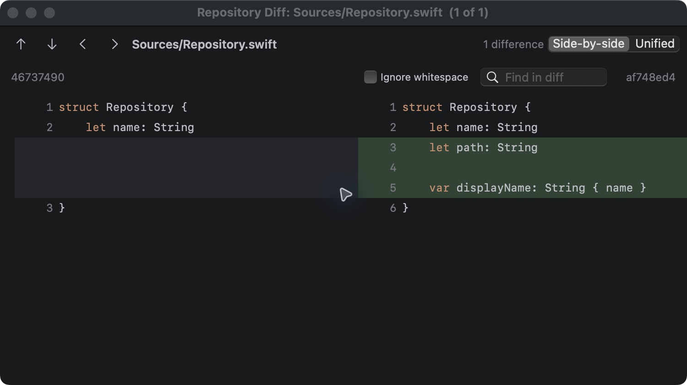

# 调查与验证记录

## 2026-10-10 大仓库切换分支时卡死

- 用户提供的系统报告为 `Event: hang`，采样期间内存占用从 2412 MB 增长到 2555 MB；主线程卡在 NSTextView / TextKit 2 的视口排版。报告本身没有异常终止原因。
- 对仍运行的旧版再次采样，捕获到 `RepositoryController.appendConsole` 中 `String.count` 占据主线程。用户补充触发场景为 new-api 中切换分支。实际打开的 new-api 仓库一次 2000 条历史查询输出约 811 KB，旧版每次仅删除 100,000 个 UTF-16 单元，无法维持日志上限；隐藏的 Console 也强制滚动。
- Console 在后台截断单条输出，插入前按 UTF-16 长度修剪总量至 200,000 单元，替换机器输出中的控制分隔符；使用显式 TextKit 1 文本网络并停止隐藏时滚动。切换项目清空 Console，丢弃上个项目延迟回来的日志。Git 实际查询结果不截断。
- 新增真实 NSTextStorage 回归检查：反复追加超大含中文、emoji、NUL 的文本，验证总量上限、清空、已有超限文本恢复、错误退出信息和截断标识。约 1.3 秒完成 100 次大输出追加；原有 **32 scenarios, 0 failures**。
- 在最终打包应用中通过 Computer Use 打开 new-api，切换本地 main 与 origin/main 的历史筛选，打开 Console、手动刷新再返回 Log，均正常响应；Console 截断标识可见，状态仍显示 2000 commits。此次没有 checkout 或修改用户仓库。初版修复运行约一分钟时 RSS 约 147 MB，CPU 约 1%，未再现旧版持续满核；这是短时验收，不能替代长期运行检查。
- Release 构建、严格签名验证及 `git diff --check` 通过。

验证日期：2026-10-08。本机 macOS / Apple Silicon，Swift 6.1.2 Command Line Tools。

## IDEA 参考

通过 Computer Use 查看了本机已打开的 IntelliJ IDEA，以及自己创建的 `/tmp/gitdesk-demo` 测试仓库。用户原有项目仅用于查看界面，没有执行 Git 写操作。

- 用户截图中的空仓库 Log：Git / Log / Console 标题、分支搜索、本地分支树、消息/哈希搜索、Branch / User / Date 筛选、右侧文件变化和详情。
- 测试仓库中的 Log：包含 merge 的提交图、分支/标签标记、作者和日期列、选中提交的详情、按目录分组的文件变化。
- 分支菜单：Checkout、创建分支、Compare、与工作区比较、Rebase、Merge、Worktree、Push、重命名和删除。
- Commit 面板：工作区变化、文件勾选、提交消息、Amend 与 Diff。
- 双击修改文件后的 Diff：左右版本、行号、变化背景、差异导航与空白选项。

原始参考截图：[idea-reference.png](idea-reference.png)。IDEA Diff 实际截图：[idea-diff.png](idea-diff.png)。

## 原生应用验证

在打包的 `dist/GitDesk.app` 中通过 Computer Use 验证了：

- 打开仓库、Log 三栏布局、分支文件夹、提交图、提交详情和目录变化树。
- 消息搜索、分支菜单和新建分支窗口。
- 新建 `test/ui-verification` 分支，仅勾选 `Sources/Repository.swift` 创建提交；其他未跟踪文件仍保留在工作区。
- 单击提交读取详情，以及双击提交/文件打开 Diff。
- Side-by-side / Unified 切换、忽略空白选项、Commit 面板内文件预览。
- 窗口与嵌入面板的 Diff 列宽适配；Commit 消息占位文字与深色复选框文字。

所有实际提交操作都在自行创建的测试仓库内完成。仓库初始数据和作者信息为测试数据。

最终界面截图：

## 自动检查

### Commit Message 输入修复

后续实际输入检查发现，消息框中的 `NSTextView` 未配置滚动容器内的尺寸跟踪，宽度为零，导致边框和占位文字可见，但点击不能获得焦点。已为文本滚动容器统一配置宽度跟踪、纵向扩展与最小视口高度，并显式启用消息编辑、选择和撤销。

修复后的 release 应用已通过 Computer Use 实际验证：点击消息框获得焦点，键盘英文输入、换行、中文粘贴、撤销和刷新保留消息。测试文字已清除，没有执行提交。截图：[gitdesk-message-input.png](gitdesk-message-input.png)。

`scripts/test.sh` 的结果为 **22 scenarios, 0 failures**。检查使用临时仓库和本地 bare remote，无真实网络远程操作。

覆盖初始提交、选择文件提交、失败后的 index 保留、amend、特殊文件名与路径、符号链接、预览大小限制、重命名、暂存区/工作区 Diff、历史筛选、分支与标签 checkout、stash、本地 push/fetch/pull、冲突与中止、merge 父提交、rebase、worktree、cherry-pick、revert、reset、rollback、提交图与文本差异算法。完整结果见 [regression-results.txt](regression-results.txt)。

`scripts/build-app.sh` 的 release 构建成功；`codesign --verify --deep --strict dist/GitDesk.app` 验证通过。打包应用约 1 MB，使用本机 ad-hoc 签名，尚未做 Developer ID 签名或公证。

## 复刻范围

2026-10-10 Log 视觉调整：依据用户提供的两张对比截图，改为扁平描边搜索框（文本搜索的正则与大小写按钮在框内）、单箭头筛选按钮、按视口分配消息列宽、完整日期时间、当前 Git 身份作者加粗、无底色的描边引用标签、矩形低饱和选中效果、直线提交图和 HEAD 空心环。分支改为收藏优先再按名称排序，main/master 默认收藏；刷新保留折叠状态并取消初次自动选中。工具栏收紧，右侧空状态居中，分隔线使用统一颜色。Release 构建及签名检查通过。用户在授权界面启用 GitDesk 后，Computer Use 仍返回 `Computer Use was not approved to use GitDesk`，刷新工具会话后结果相同；此版未通过实际界面验收，以上描述为代码实现，不能视为像素一致性已验证。

2026-10-10 标题栏调整：通过 IDEA 实际项目菜单对照，确认 `gitdesk-demo` 为绿色 GD、`git-view` 为青色 GV，并查看了项目颜色开关和自定义 SVG 图标对话框（已取消，未保存设置）。GitDesk 标题栏已改为同一行的原生窗口按钮、仓库下拉和分支下拉；字母按仓库名称生成，颜色按规范化仓库路径稳定生成，仓库菜单也使用相同标识。颜色分配算法未与 JetBrains 内部算法核对，自定义 SVG 图标功能此次未实现。Release 构建通过；此次界面验收因 Computer Use 尚未获准访问 GitDesk 而待完成。

### 2026-10-10 后续实际界面验收

Computer Use 已恢复访问 GitDesk。上述“待完成”描述记录的是此前授权受阻时的状态；本次已在最新打包应用中完成以下实际检查，并再次查看 IDEA 的测试仓库界面：

- 标题栏改用原生 `NSTitlebarAccessoryViewController`，修复窗口标题栏覆盖按钮点击区域的问题；补充原生紧凑工具栏，修复顶部控件被裁切。仓库按钮中央点击可打开菜单，分支按钮也可打开操作菜单。
- 最近仓库按规范化路径去重，避免 `/tmp` 与 `/private/tmp` 出现重复条目。仓库字母和颜色随仓库生成。
- 分支搜索输入 `feature` 可正确过滤；清空后恢复目录树，刷新保留折叠状态。修复搜索后的横向偏移，根节点文字完整可见。
- Log 搜索输入 `hello` 后从 9 条过滤为 1 条，清空后恢复 9 条。搜索框编辑时文字与静态显示位置一致。
- 按 IDEA 对照补充当前分支可达提交的淡靛色背景、独立的选中效果、HEAD 洋红色空心环、青色主线与紫色支线；过滤时保留历史图颜色。
- 引用名称采用紧凑描边标签，多引用使用叠放图标。分支树使用原生绘制的分支图标，收藏优先排序；日期显示完整时间，当前 Git 身份作者加粗。
- Commit 消息框可输入英文、换行与粘贴中文，刷新后保留草稿。验收文字已清除，没有执行提交或其他 Git 写操作。
- 连续选择不同提交时详情正确更新，正文保持常规字重，标题加粗。

最新 release 构建成功，`codesign --verify --deep --strict dist/GitDesk.app` 验证通过。本轮修改集中于界面，未重新执行此前的 22 项核心回归场景。

核心布局、深色配色、信息结构与常用 Git 操作按实际 IDEA 界面实现。没有进行像素差异自动验收，也未达到 IDEA 所有高级功能的完整等价。macOS 系统字体和 SF Symbols 与 JetBrains 的字体、图标存在差别。功能边界及预览限制见 [中文 README](../README.zh-CN.md#当前限制)。

## 2026-10-10 开源整理检查

- 环境：Apple Silicon、Swift 6.1.2。
- 再次执行 `./scripts/test.sh`：**22 scenarios, 0 failures**。
- `./scripts/build-app.sh` Release 打包成功，`codesign --verify --deep --strict dist/GitDesk.app` 通过。
- 补充中英文 README、MIT 许可、第三方说明、贡献指南、安全说明、变更记录及 Issue/PR 模板。
- GitHub Actions 配置 Apple Silicon / Intel macOS 回归检查和打包；本地检查不代表远程 CI 已通过。
- README 截图来自 2026-10-08 的演示仓库验证，不代表最新版本的像素验收。

## 2026-10-10 分支和标签筛选延迟优化

在本机 `/private/tmp/gitdesk-demo`（9 条提交）用优化前、后的 release 核心代码测量。原先切换筛选会重建整个仓库快照，执行 11 条串行 Git 命令，包含引用、完整历史、筛选历史、工作区状态、remote 和 stash 查询。原有进程轮询和等待退出路径使每条小查询也耗时约 90 ms。

改为进程终止回调唤醒等待线程，保留 120 秒超时处理；分支、标签及其他 Log 筛选只读取筛选历史，复用上次快照中的引用、工作区、stash 和完整历史。显式刷新、Git 写操作后的刷新和每 5 秒的后台刷新仍读取完整仓库。后台定时器在已有刷新进行时跳过，连续请求合并时保留完整刷新需求。

| 测量项 | 结果 |
| --- | --- |
| 优化前 main 筛选，全量快照，5 次 | 中位数 1,032.5 ms，范围 1,008.9–1,046.4 ms，11 条命令 |
| 仅优化进程等待，仍为全量快照，单次 | 85.0 ms，11 条命令 |
| 优化后 main 筛选，10 次 | 中位数 19.6 ms，范围 18.9–20.9 ms，3 条命令 |
| 优化后 v0.1.0 标签筛选，10 次 | 中位数 18.9 ms，范围 18.4–20.7 ms，3 条命令 |

以上为后台查询耗时，包含进程启动和解析，不包含 AppKit 界面绘制，也不代表大型仓库的固定耗时。通过 Computer Use 在重启后的 release 应用中双击 main 与 v0.1.0，分别显示 6 条、5 条提交，状态栏已恢复正常，不停留在 Refreshing。GUI 验收没有执行 Git 写操作。

新增筛选快照回归检查，覆盖分支、HEAD、annotated tag、搜索、无效引用及表达式；确认结果与直接 Git 查询一致，且保留原有工作区变化和历史。`./scripts/test.sh`：**23 scenarios, 0 failures**。Release 构建及签名验证通过。

## 2026-10-10 提交右键菜单与历史编辑

新增 Undo Commit、Edit Commit Message（最新及更早提交）、父/子提交跳转、Create Patch、历史版本文件树，以及 Drop、Squash、Fixup 和交互式 rebase 编辑器。编辑器按从旧到新展示提交，可上下移动、改写说明、合并或删除；无效计划会保留编辑内容并提示修正。操作暂停后显示解决冲突、继续、跳过和中止入口。

`./scripts/test.sh`：**31 scenarios, 0 failures**。新增 8 项场景覆盖：撤销/改写时保留暂存及工作区修改、根提交、已发布引用提示、过期 HEAD 与同一 tip 的分支切换拦截、补丁往返应用、含空格及单引号的仓库路径、特殊文件名、只读 blob/符号链接/子模块及大小限制、排序/改写/删除/合并、自动合并说明、冲突继续/跳过/中止、持久化消息文件、计划校验及多子提交关系。Release 构建成功，`codesign --verify --deep --strict dist/GitDesk.app` 和 `git diff --check` 通过。

通过 Computer Use 在独立临时仓库 `/private/tmp/gitdesk-history-ui.xzhz2rnk` 实际验证：

- 最新提交说明和较早提交说明均可修改，支持多行中文正文；较早提交的后续历史成功重放。
- Squash 合并两个提交并使用新说明；Undo 将修改保留为暂存状态、回填原说明，再提交成功。
- 父/子跳转选择正确提交；原生保存面板导出补丁，检查文件包含对应作者、说明与修改。
- 历史文件树仅显示所选版本当时存在的文件，内容可以选择和复制，不能编辑。
- 将计划首行设为 Squash 后执行被拦截，返回编辑器时动作保留。
- 交换两个修改同一文件的提交顺序，确实产生 rebase 冲突；界面出现恢复操作栏。点击中止后，HEAD 恢复至 `57706d1`，文件内容恢复为 `two`，工作区干净，临时会话目录清理完成。继续与跳过的完成路径由核心回归场景验证。

上述 Git 写操作均在专用测试仓库进行，项目仓库历史未被改写。界面截图已在验收对话中检查；本节未新增静态截图文件。

当前边界：历史编辑只支持当前分支的线性范围，最多 10,000 条，范围含 merge 时明确拒绝；rebase 要求工作区及暂存区干净。已发布提示依据本地 remote-tracking 引用，不查询托管平台的分支保护；应用不执行强制推送。merge 补丁导出为相对第一父提交的二进制兼容 diff，普通提交为 Git-format patch。历史文件内容预览上限为 2 MB。

## 2026-10-10 标题栏文字对齐

根据用户提供的 GitDesk / IDEA 标题栏截图，并用 Computer Use 查看两个应用，调整仓库名和分支名的垂直位置、字重与间距。右侧原生 accessory 的高度会随紧凑工具栏布局变化，改为将窗口按钮的实际中心转换到 accessory 坐标后排列控件；窗口初始化及缩放完成后再次同步布局。仓库标识向右留出更多空隙，标题改用 13 pt 常规字重，分支图标缩为 14 pt，并将图标到文字的起始间距由 26 pt 收紧为 20 pt。文字绘制位置按 backing scale 对齐像素。

在演示仓库实际查看截图，验证仓库菜单和分支菜单可以打开，窗口放大和恢复后标题栏仍完整显示。未执行 Git 写操作。验收截图已在对话中查看，未新增静态截图文件；未进行自动像素差异验收。`./scripts/test.sh` 仍为 **31 scenarios, 0 failures**，最终 Release 构建、签名检查和空白检查通过。

## 2026-10-10 移除外侧工具栏

按用户截图移除最左侧的 Commit / Log / Stashes / Console 竖向工具栏及其 42 pt 布局占位。Git 主面板两侧统一保留 10 pt 窗口边距，顶部 Log / Console / Commit 标签与 Git 菜单继续提供入口。Release 构建后通过 Computer Use 检查截图及可访问性结构，确认外侧工具栏消失、主面板向左扩展，内部的分支操作栏仍显示。签名和空白检查通过；本次仅修改布局，未再次运行核心回归。

## 2026-10-10 Commit 面板对照与交互检查

通过 Computer Use 查看运行中的 IntelliJ IDEA，在 `/private/tmp/gitdesk-demo` 对照 Commit 面板截图和可访问性结构，并实际用空格键勾选/取消勾选 Unversioned Files 分组。IDEA 的工具栏独立于 Changes 树，文件使用缩进的勾选框、类型图标、文件名及灰色目录；数量紧跟分组名，消息区有独立分隔线，历史按钮位于 Amend 旁。打开 IDEA 底部齿轮确认作者和 Sign-off 属于提交设置，代码格式化、导入整理、分析等属于编辑器检查。检查后关闭弹窗，文件仍未勾选、消息为空，未执行提交。

GitDesk 改为独立工具栏、单列分组变更树、24 pt 行高、圆角蓝色行选择、文件名加灰色目录、行内数量及分组半选框。底部采用可拖动的消息区、细圆角边框、Amend / last commit 菜单及相邻的消息历史入口、28 pt 主次提交按钮和真正的提交设置入口。目录及状态显示选项保留在顶部 View Options 中。直接勾选和空格勾选只更新单元格，避免整表重载丢失当前选中行；全量刷新按文件路径及分组名恢复选择。

在演示仓库实际验证：

- 单文件勾选使分组变为半选，再点击可取消；对分组连续按两次空格可全选并恢复全不选，当前选中行保持。
- 左/右方向键收起及展开文件组；显式刷新保留分组选择及文件勾选状态。
- 输入英文及中文多行消息，显式刷新后正文保持；清空测试消息后勾选 Amend，正确回填 main 最新提交说明，随后恢复未勾选及空消息。
- 拖动消息区上方分隔线，将树区域从 316 pt 调到 266 pt，再恢复 316 pt；消息正文保持。
- 消息历史菜单正常打开；目录显示可以关闭并恢复。

最终构建重启后，在当前打开的干净仓库验证底部提交设置：输入测试作者、启用 Sign-off、保存，再打开时两项正确回显；随后恢复空作者及关闭 Sign-off，并再次打开确认。未执行任何仓库提交、暂存或其他 Git 写操作。界面截图已在本次验收对话中检查，未新增静态截图文件，也未做自动像素差异验收。IDEA 的编辑器检查、AI 助手和 shelf 功能未移植；GitDesk 工具栏使用已有 stash 功能。

新增作者及 Sign-off 回归场景，覆盖首次提交、amend、无效作者失败时保留 HEAD/index、无关暂存文件保留；merge 场景同时检查作者和 Sign-off。`./scripts/test.sh`：**32 scenarios, 0 failures**。最终 Release 构建、签名检查和空白检查通过。中英文 README、Changelog 已同步。

## 2026-10-10 提交双击及项目窗口行为

移除 Log 提交表的双击 Diff 动作，保留选择及右侧详情更新，以及显式 Show Diff / ⌘D。项目窗口现在各自拥有 RepositoryController 和标题栏，菜单快捷键跟随当前激活的项目窗口。⌘O、最近项目菜单和系统打开文件事件复用当前项目窗口，⌘N 创建独立的空白窗口；禁用系统自动合并为标签页。关闭项目窗口时停止它的刷新定时器并关闭其附属窗口。

Release 构建重启后通过 Computer Use 实际验证：

- 在原 `new-api` 窗口双击提交，仍显示项目主窗口，并更新该提交的文件树和正文；没有弹出 Diff 窗口。
- ⌘N 创建空白 GitDesk 窗口，Window 菜单同时列出 GitDesk 和原 new-api 项目。
- 在空白窗口按 ⌘O，通过原生目录选择面板打开 `/private/tmp/gitdesk-demo`，随后通过最近项目菜单切换为 git-desktop；Window 菜单始终只有两个项目窗口。
- 用 Window 菜单切回 new-api，原提交选择及详情仍保留；⌘K 正确切换该窗口的 Commit 页，另一个窗口仍为 Log。
- 关闭测试窗口后，原 new-api 窗口仍在，⌘K 和 ⌘1 均正常；最后恢复原窗口的 Log 页。截图已在对话中检查。

界面验收未执行 Git 写操作。`./scripts/test.sh`：**32 scenarios, 0 failures**；Release 打包、签名验证及空白检查通过，中英文使用说明及 Changelog 已更新。系统通过 Finder 打开目录的完成路径由同一个当前窗口路由处理，本轮未单独操作 Finder。

## 2026-10-10 移除分支栏收起按钮

移除分支操作栏顶部的 Hide Git Branches（左箭头），其他按钮保持原有位置；View 菜单里的 Show / Hide Branches 仍可使用。Release 构建后通过 Computer Use 检查实际界面截图和可访问性结构，确认左箭头及其工具提示入口消失，新建分支等其余按钮保留。打包、签名验证和空白检查通过；本次仅移除按钮，未重复执行核心回归。
